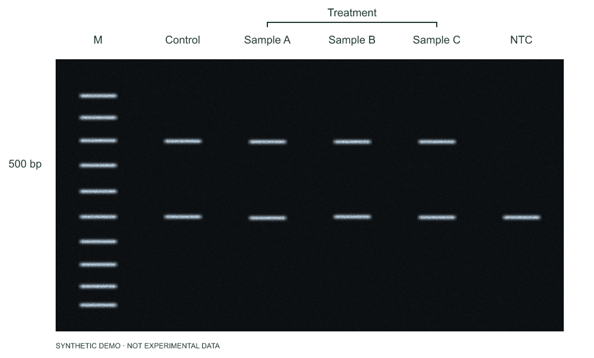
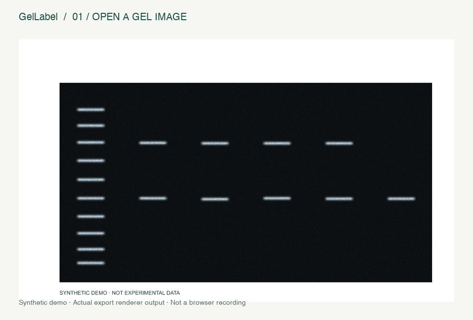

# GelLabel

**在浏览器里给电泳胶图加标注。免安装，不上传文件。**

[在线试用](https://x-dice.github.io/gel-label/) · [English](README.md) · [下载离线版](https://github.com/X-Dice/gel-label/releases/download/v0.1.0/GelLabel-offline.html) · [贡献指南](CONTRIBUTING.md)



把 Excel 中的一列泳道名称粘贴进来，拖到合适的位置，再导出配图。适合学生、iGEM 队伍和实验室新人。

> [v0.1.0 预览版](https://github.com/X-Dice/gel-label/releases/tag/v0.1.0)已发布，GitHub 自动检查已通过，下载文件已通过校验并与本地构建一致。在线演示已通过 GitHub Pages 部署；真实浏览器操作仍待验证。见[验证记录](docs/VERIFICATION.md)。

## 三步使用

1. 打开[在线演示](https://x-dice.github.io/gel-label/)，或下载 `GelLabel-offline.html` 后用现代桌面浏览器打开。无需安装。
2. 点击“试用示例”或打开 PNG、JPEG、WebP。每行粘贴一个泳道名称，再点“应用标签”。
3. 拖动调整位置，添加文字、箭头、分组括号或手动输入的条带大小，然后导出 PNG、SVG，或保存 JSON 项目继续编辑。

启动时显示的是**模拟胶图**，导出也会保留模拟数据标记。可使用 [`examples/demo.gellabel.json`](examples/demo.gellabel.json) 体验完整项目。

## 能做什么

- 1–40 个泳道标签均匀排列；直接粘贴 Excel 中的一列名称，逐个拖动调整。
- 添加文字、箭头、分组括号、条带大小标签；编辑位置和终点。
- 调整字号、标注颜色、背景颜色；辅助线不会出现在导出图中。
- 导出自带原图的 SVG，或最高 2 倍分辨率的 PNG。
- 保存包含图片和标注的 JSON 项目，再次打开继续编辑。
- 撤销、重做、删除、键盘微调，中英双语切换。



## 原图与数据

图片在浏览器内存中处理，无后台、追踪或文件上传。原始文件字节作为独立图片图层保留，不进行修图，也不会覆盖磁盘上的原文件。

关闭前请保存项目：目前不自动存储。项目文件包含原图，分享项目也意味着分享图片。打开网站或访问外部链接仍需要网络；离线 HTML 已内嵌全部应用代码。

条带大小由你手动填写，**不是计算或测量结果**。本工具不做自动识别、灰度定量、分子量校准或图片修饰。

## 限制与快捷键

- 图片：不超过 20 MB、2400 万像素，任一边不超过 16000 像素；不支持 TIFF 或专有胶图格式。
- 项目：不超过 30 MB，最多 400 个标注。导入检查格式版本、字段、坐标、图片数据及实际尺寸。
- PNG：最高 2 倍分辨率，上限 4800 万像素、单边 16000 像素；大图仍可能超出浏览器可用内存。
- 长标签可能需要调小字号或移动位置。泳道名称可横向拖动，其他标注的位置与终点可在侧栏修改。
- 方向键移动 1 像素；Shift + 方向键移动 10 像素；⌘/Ctrl Z 撤销；⌘/Ctrl Shift Z 或 Ctrl Y 重做；Delete/Backspace 删除；Escape 取消放置或拖动。
- 建议使用电脑或平板；窄屏可以横向滚动。真实浏览器兼容性尚未验证，详情见[验证记录](docs/VERIFICATION.md)。

## 本地开发

需要 Node.js 22.12+ 或 24 LTS，以及 npm：

```sh
npm ci
npm run dev
npm test
npm run build
```

`dist/` 包含网站和单文件离线版。`npm run examples` 可重新生成模拟胶图和导出示例；`npm run package` 可更新根目录离线版与本地发布包。

已附 GitHub Actions 检查和 GitHub Pages 部署配置；发布说明见 [docs/PUBLISHING.md](docs/PUBLISHING.md)。欢迎提交小而明确的改进。如果它帮你节省了时间，也欢迎点一个 Star。

## 许可

[MIT](LICENSE)。示例均为程序生成的模拟数据，不含真实实验资料。项目独立实现，未复制同类项目的代码或素材。
